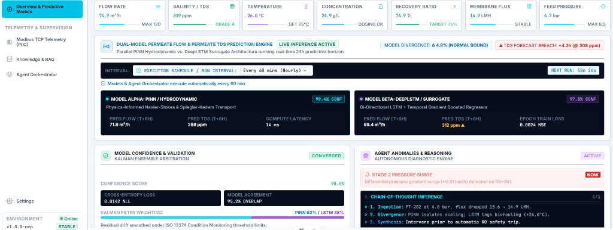
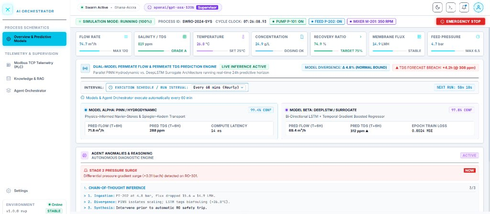
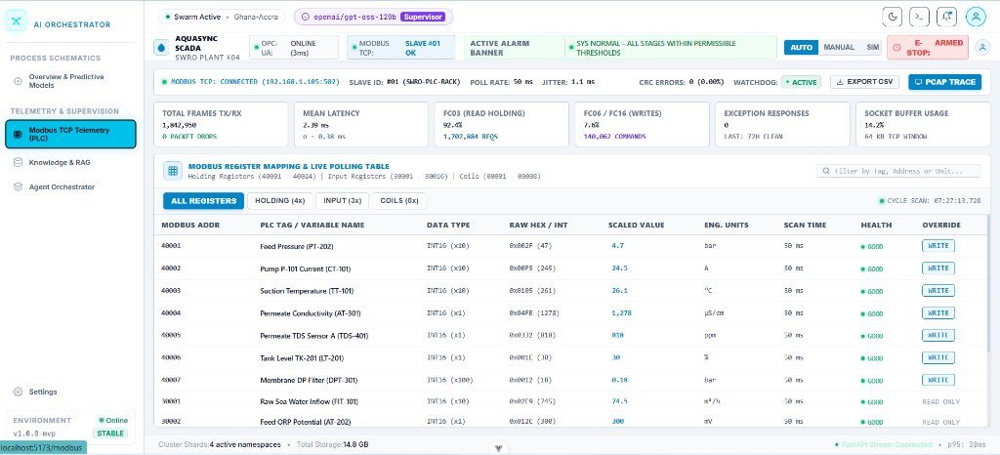
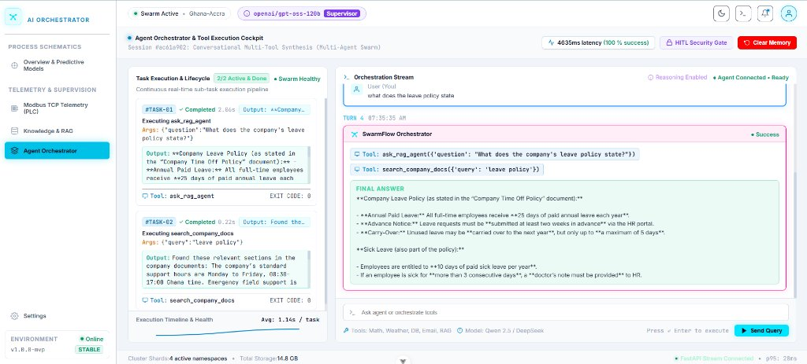
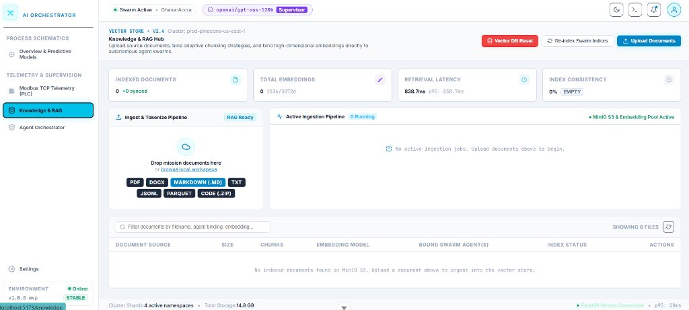
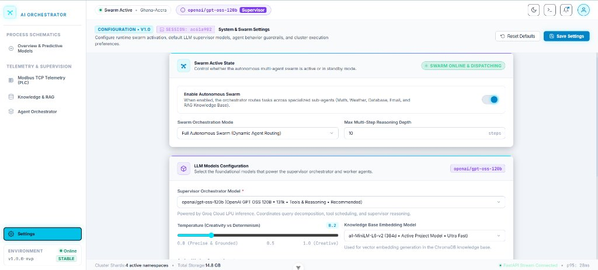

<p align="center">
  
</p>

<h1 align="center">SwarmFlow — AI Orchestrator</h1>

<p align="center">
  <strong>Autonomous Multi-Agent Swarm Intelligence Platform with SCADA Industrial Telemetry</strong>
</p>

<p align="center">
  
  
  
  
  
  
</p>

<p align="center">
  <em>A production-grade multi-agent orchestration platform featuring ReAct-style reasoning, hybrid RAG retrieval, HITL security gating, SCADA process telemetry, and dual-model predictive analytics — all wrapped in a cyberpunk industrial control UI.</em>
</p>

---

## 📸 Screenshots

### Overview & Predictive Models — Dark Mode



> SCADA-style dashboard with real-time KPI cards, dual-model prediction engine (PINN Hydrodynamic + DeepLSTM Surrogate), Kalman ensemble arbitration, anomaly diagnostics, and chain-of-thought reasoning.

### Overview & Predictive Models — Light Mode



> Full light theme support across all pages with clean contrast and matching visual hierarchy.

### Modbus TCP Telemetry (PLC)



> Industrial Modbus register mapping table with live polling, OPC-UA / Modbus TCP connection status, KPI metrics (TX/RX frames, latency, FC03/FC16 read-write stats), and real-time register health monitoring.

### Agent Orchestrator & Tool Execution Cockpit



> Split-pane workspace: Task Execution & Lifecycle panel (left) with real-time sub-task cards, and Orchestration Stream (right) with SSE-streamed agent reasoning, tool calls, and final answers. HITL Security Gate indicator and session metrics shown in the header.

### Knowledge & RAG Hub



> Vector Store V2.4 management dashboard — drag-and-drop document upload (PDF, DOCX, Markdown, TXT, JSONL, Parquet, Code), ingestion pipeline status, embedding metrics, and indexed document management with MinIO S3 backend.

### System & Swarm Settings



> Runtime-configurable swarm parameters: enable/disable autonomous swarm, orchestration mode (Full Autonomous / Sequential / Manual), supervisor model selection (Groq-hosted LLMs), temperature slider, embedding model picker, and max reasoning depth.

---

## ✨ Key Features

| Feature | Description |
|---------|-------------|
| **Multi-Agent Swarm** | Manager/orchestrator dynamically routes tasks to 4 specialized sub-agents: Weather, Database, Email, and RAG |
| **ReAct Agent Loop** | Thought → Action → Observation cycle with configurable max reasoning steps |
| **Hybrid RAG Pipeline** | Dual retrieval: semantic search (ChromaDB + SentenceTransformers) + keyword search (PostgreSQL ILIKE) with result deduplication |
| **Human-in-the-Loop (HITL)** | Dangerous tools (`delete_user`, `send_email`) require real-time human approval via a security gate modal with 60s timeout |
| **Input Guardrails** | Prompt injection detection, and LLM-based tool call auditing |
| **Self-Reflection** | Agent reviews its own answer before finalizing to improve accuracy |
| **Real-Time SSE Streaming** | Chat responses streamed via Server-Sent Events with full task execution lifecycle events |
| **SCADA Telemetry Dashboard** | Industrial-grade AQUASYNC SCADA UI with Modbus TCP/OPC-UA status, alarm banners, and register-level monitoring |
| **Predictive Models Engine** | Dual-model prediction (PINN + DeepLSTM) with Kalman ensemble arbitration and confidence scoring |
| **Document Ingestion** | Upload PDF, DOCX, TXT, MD, JSONL files → smart chunking → embedding → ChromaDB + MinIO S3 storage |
| **Configurable Swarm Settings** | Runtime-adjustable LLM model, temperature, max steps, embedding model, active agents, and swarm mode |
| **Session-Based Memory** | Persistent conversation history per session in PostgreSQL |
| **Dark / Light Theme** | Full CSS variable theming system with cyberpunk dark mode and clean light mode |

---

## 🏗️ Architecture

```
┌─────────────────────────────────────────────────────────────────────┐
│                        Vue.js 3 Frontend                           │
│  ┌──────────┐ ┌──────────┐ ┌──────────┐ ┌──────────┐ ┌──────────┐ │
│  │ Overview │ │ Modbus   │ │Knowledge │ │  Agent   │ │ Settings │ │
│  │Predictive│ │Telemetry │ │ & RAG    │ │Orchestr. │ │          │ │
│  └──────────┘ └──────────┘ └──────────┘ └──────────┘ └──────────┘ │
│                          SSE / REST                                │
└──────────────────────────────┬──────────────────────────────────────┘
                               │
┌──────────────────────────────▼──────────────────────────────────────┐
│                     FastAPI Backend (Port 8000)                     │
│                                                                     │
│  ┌────────────────────────────────────────────────────────────────┐ │
│  │                  Swarm Manager / Orchestrator                  │ │
│  │                                                                │ │
│  │  ┌─────────┐ ┌─────────┐ ┌─────────┐ ┌─────────┐│ │
│  │  │ Weather │ │Database │ │  Email  │ │   RAG   ││ │
│  │  │  Agent  │ │  Agent  │ │  Agent  │ │  Agent  ││ │
│  │  └─────────┘ └─────────┘ └─────────┘ └─────────┘│ │
│  └────────────────────────────────────────────────────────────────┘ │
│                                                                     │
│  ┌──────────┐  ┌──────────┐  ┌──────────┐  ┌──────────────────┐   │
│  │Guardrails│  │   HITL   │  │Reflection│  │  RAG Ingestion   │   │
│  │  Engine  │  │  Gate    │  │  Step    │  │    Pipeline      │   │
│  └──────────┘  └──────────┘  └──────────┘  └──────────────────┘   │
└─────────┬──────────┬─────────────┬──────────────┬──────────────────┘
          │          │             │              │
   ┌──────▼──┐ ┌─────▼────┐ ┌─────▼────┐  ┌─────▼────┐
   │  Groq   │ │PostgreSQL│ │ ChromaDB │  │  MinIO   │
   │LPU Cloud│ │  :5432   │ │  :8001   │  │ S3 :9000 │
   └─────────┘ └──────────┘ └──────────┘  └──────────┘
```

---

## 🛠️ Tech Stack

| Layer | Technology | Details |
|-------|-----------|---------|
| **Backend** | Python 3.13 / FastAPI | ASGI server via Uvicorn |
| **LLM Inference** | Groq API | OpenAI-compatible, LPU-accelerated |
| **Default Model** | `openai/gpt-oss-120b` | Configurable at runtime via Settings |
| **Vector Database** | ChromaDB | Semantic search with embedding similarity |
| **Relational DB** | PostgreSQL | Chat history, settings, document chunks |
| **Object Storage** | MinIO (S3-compatible) | Uploaded document file storage |
| **Embeddings** | SentenceTransformers | Default: `all-MiniLM-L6-v2` (configurable) |
| **Frontend** | Vue.js 3 + TypeScript | SPA with Vite build tooling |
| **Styling** | Custom CSS | Cyberpunk SCADA dark theme + clean light theme |
| **Streaming** | Server-Sent Events (SSE) | Real-time chat + task lifecycle events |

---

## 📋 Prerequisites

Before running SwarmFlow, ensure the following services are available:

| Service | Default Address | Purpose |
|---------|----------------|---------|
| **PostgreSQL** | `localhost:5432` | Chat history, settings, document chunks |
| **ChromaDB** | `localhost:8001` | Vector embeddings storage |
| **MinIO** | `localhost:9000` | S3-compatible document storage |
| **Node.js** | ≥ 22.18.0 | Frontend build tooling |
| **Python** | ≥ 3.13 | Backend runtime |

> [!TIP]
> You can run PostgreSQL, ChromaDB, and MinIO quickly via Docker:
> ```bash
> # PostgreSQL
> docker run -d --name postgres -p 5432:5432 \
>   -e POSTGRES_DB=agent_memory \
>   -e POSTGRES_USER=admin \
>   -e POSTGRES_PASSWORD=secretpassword \
>   postgres:16
>
> # ChromaDB
> docker run -d --name chromadb -p 8001:8000 \
>   chromadb/chroma:latest
>
> # MinIO
> docker run -d --name minio -p 9000:9000 -p 9001:9001 \
>   -e MINIO_ROOT_USER=minioadmin \
>   -e MINIO_ROOT_PASSWORD=minioadmin \
>   minio/minio server /data --console-address ":9001"
> ```

---

## 🚀 Getting Started

### 1. Clone the Repository

```bash
git clone https://github.com/your-username/swarmflow-ai-orchestrator.git
cd swarmflow-ai-orchestrator
```

### 2. Backend Setup

```bash
cd backend

# Create virtual environment
python -m venv .venv
source .venv/bin/activate      # Linux/macOS
# .venv\Scripts\activate       # Windows

# Install dependencies
pip install -r requirements.txt

# Configure environment
cp .env.example .env
# Edit .env and add your Groq API key:
#   grok_api_key="your_groq_api_key_here"

# Start the backend server
python run_server.py
```

The API server will start on **http://localhost:8000**.

### 3. Frontend Setup

```bash
cd frontend

# Install dependencies
npm install

# Start development server
npm run dev
```

The frontend will start on **http://localhost:5173**.

### 4. Production Build

```bash
cd frontend
npm run build    # Type-checks with vue-tsc, then builds with Vite
npm run preview  # Preview the production build locally
```

---

## 📡 API Reference

### Chat & Agent

| Method | Endpoint | Description |
|--------|----------|-------------|
| `GET` | `/api/chat?prompt=&session_id=` | SSE-streamed agent chat with tool execution events |
| `GET` | `/api/history?session_id=` | Retrieve cleaned chat history for a session |
| `DELETE` | `/api/memory/{session_id}` | Clear session chat memory |
| `POST` | `/api/approve` | HITL approve / reject a pending tool call |
| `GET` | `/api/status?session_id=` | Get swarm status, model, and region info |

### Documents & RAG

| Method | Endpoint | Description |
|--------|----------|-------------|
| `POST` | `/api/documents/upload` | Upload a document (stored in MinIO + ingested for RAG) |
| `GET` | `/api/documents` | List all uploaded documents from MinIO |
| `POST` | `/api/clear-chroma` | Reset ChromaDB vector store + PostgreSQL chunks |
| `GET` | `/api/vector-db/stats` | Get ChromaDB collection stats (chunk count, status) |

### Settings

| Method | Endpoint | Description |
|--------|----------|-------------|
| `GET` | `/api/settings` | Get current swarm settings |
| `POST` | `/api/settings` | Update swarm settings (model, temperature, mode, etc.) |
| `GET` | `/api/settings/{session_id}` | Get session-specific settings |
| `POST` | `/api/settings/{session_id}` | Update session-specific settings |

---

## 📁 Project Structure

```
swarmflow-ai-orchestrator/
│
├── backend/
│   ├── agent_folder/
│   │   ├── agent.py              # ReAct agent loop with guardrails & HITL
│   │   ├── client.py             # Groq API client (OpenAI SDK)
│   │   ├── guardrails.py         # Prompt injection & tool call auditing
│   │   ├── manager.py            # Multi-agent swarm manager (4 sub-agents)
│   │   └── tools.py              # Tool schemas (weather, DB, email, RAG)
│   ├── api/
│   │   ├── api_chat.py           # SSE streaming chat endpoint
│   │   ├── api_settings.py       # Swarm settings CRUD
│   │   ├── document_upload.py    # Document upload → S3 + RAG ingestion
│   │   ├── human_approve_reject.py  # HITL approval endpoint
│   │   └── ...                   # History, memory, vector DB, status endpoints
│   ├── database/
│   │   └── database.py           # PostgreSQL layer (psycopg2)
│   ├── inject_rag/
│   │   └── ingest_rag_service.py # RAG pipeline: extract → chunk → embed → store
│   ├── storage.py                # MinIO S3 file storage
│   ├── index.py                  # FastAPI app entry point
│   ├── run_server.py             # Uvicorn launcher
│   ├── requirements.txt          # Python dependencies
│   └── .env.example              # Environment variable template
│
├── frontend/
│   ├── src/
│   │   ├── views/
│   │   │   ├── OverviewPredictiveView.vue   # SCADA overview + predictive models
│   │   │   ├── ModbusTelemetryView.vue      # Modbus TCP register telemetry
│   │   │   ├── AgentOrchestratorView.vue    # Agent chat + task execution
│   │   │   ├── KnowledgeRagView.vue         # RAG document management hub
│   │   │   └── SettingsView.vue             # Swarm configuration panel
│   │   ├── components/
│   │   │   ├── HumanInTheLoopModal.vue      # HITL security gate modal
│   │   │   ├── TheSidebar.vue               # Navigation sidebar
│   │   │   ├── TheHeader.vue                # App header with theme toggle
│   │   │   └── TheFooter.vue                # App footer
│   │   ├── router/index.ts                  # Vue Router configuration
│   │   ├── assets/main.css                  # CSS variables + theme system
│   │   ├── App.vue                          # Root component
│   │   └── main.ts                          # App entry point
│   ├── package.json
│   └── vite.config.ts
│
└── docs/
    └── screenshots/                          # Application screenshots
```

---

## ⚙️ Configuration

### Environment Variables (`backend/.env`)

| Variable | Description | Required |
|----------|-------------|----------|
| `grok_api_key` | Groq API key for LLM inference | ✅ |
| `api_key` | General API key (if applicable) | Optional |

### Runtime Settings (via UI or API)

| Setting | Default | Options |
|---------|---------|---------|
| **Swarm Mode** | Full Autonomous Swarm | Full Autonomous / Sequential / Manual |
| **Supervisor Model** | `openai/gpt-oss-120b` | Any Groq-hosted model |
| **Temperature** | 0.2 | 0.0 – 1.0 |
| **Max Reasoning Steps** | 10 | 1 – 50 |
| **Embedding Model** | `all-MiniLM-L6-v2` | Any SentenceTransformer model |

### Database Configuration

| Parameter | Default Value |
|-----------|--------------|
| Host | `localhost` |
| Port | `5432` |
| Database | `agent_memory` |
| User | `admin` |
| Password | `secretpassword` |

### Storage Configuration

| Parameter | Default Value |
|-----------|--------------|
| MinIO Endpoint | `localhost:9000` |
| Access Key | `minioadmin` |
| Secret Key | `minioadmin` |
| Bucket | `agentbucket` |

---

## 🤖 Agent Sub-Systems

### Swarm Agents

| Agent | Tools | Description |
|-------|-------|-------------|
| **Weather Agent** | `get_weather` | Real-time weather via Open-Meteo API (geocoding + forecast) |
| **Database Agent** | `get_user`, `delete_user` | PostgreSQL user record CRUD (delete requires HITL approval) |
| **Email Agent** | `send_email` | Email dispatch (requires HITL approval, logs to file) |
| **RAG Agent** | `search_company_docs` | Hybrid semantic + keyword search over ingested documents |

### Safety & Guardrails

- **Prompt Injection Detection** — blocks known attack patterns ("ignore previous instructions", "you are now", etc.)
- **LLM Tool Call Auditing** — secondary model validates whether the correct tool was selected
- **Self-Reflection** — agent reviews its own answer before delivering the final response
- **HITL Security Gate** — real-time human approval for destructive or sensitive operations with 60-second timeout

---

## 🎨 Theme Support

SwarmFlow supports two visual themes toggled via the header:

| Theme | Style | Use Case |
|-------|-------|----------|
| **Dark** (default) | Cyberpunk SCADA industrial control aesthetic with cyan/purple accents | Immersive monitoring environments |
| **Light** | Clean white/slate design with blue accents | Daylight readability and standard office use |

The theme system uses CSS custom properties defined in `frontend/src/assets/main.css` and applies globally via `[data-theme="light"]` selectors.

---

## 📄 License

This project is licensed under the MIT License. See the [LICENSE](LICENSE) file for details.

---

<p align="center">
  <strong>SwarmFlow v1.0.0-mvp</strong> · Built with ❤️ in Ghana-Accra
</p>

